

<picture>
  <source media="(prefers-color-scheme: dark)" srcset="./assets/banner-dark.png">
  <source media="(prefers-color-scheme: light)" srcset="./assets/banner-light.png">
  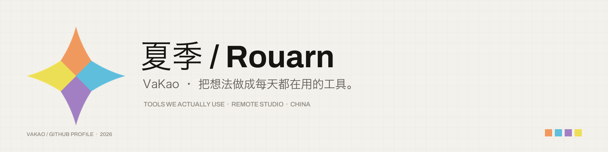
</picture>

  
  
  

### 你好，我是夏季 / Rouarn

VaKao 团队的开发者。做 Web 平台、桌面工具、移动应用与开源库；喜欢把“能用”与“好看”一起做完。

- 官网：[woyuxiaji.cn](https://woyuxiaji.cn)
- 开源项目：[woyuxiaji.cn/open-source](https://woyuxiaji.cn/open-source)
- VaKao 官网源码：[Vakao-Studio](https://github.com/Rouarn/Vakao-Studio)

---

### 现在在做

| 项目 | 一句话 |
|---|---|
| **[Vakao-Studio](https://github.com/Rouarn/Vakao-Studio)** | VaKao 团队官网：Nuxt 4 + Tailwind CSS + Three.js，静态生成。 |
| **[WireDeck](https://github.com/Rouarn/WireDeck)** | 在电脑上无线管理安卓手机：扫码配对、应用管理、APK 安装、文件传输、实时日志与 Shell。 |
| **[DianMo](https://github.com/Rouarn/DianMo)** | 点墨：Android 单机离线场景的内存扫描与修改工具。Kotlin 悬浮窗 + C++ native 扫描器。 |

---

<picture>
  <source media="(prefers-color-scheme: dark)" srcset="./assets/generated/stats-dark.svg">
  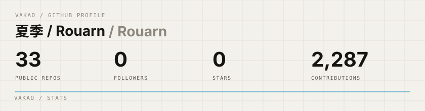
</picture>
<picture>
  <source media="(prefers-color-scheme: dark)" srcset="./assets/generated/languages-dark.svg">
  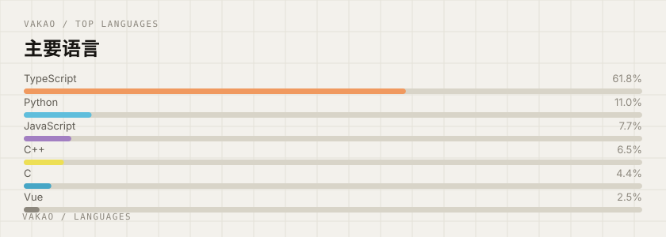
</picture>

<picture>
  <source media="(prefers-color-scheme: dark)" srcset="./assets/generated/streak-dark.svg">
  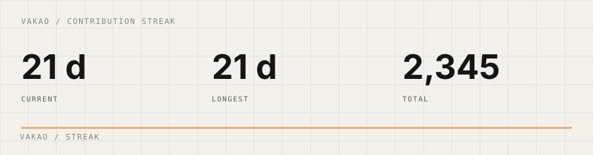
</picture>

---

### 置顶项目

<table>
<tr>
<td width="50%">
<a href="https://github.com/Rouarn/Vakao-Studio"><picture><source media="(prefers-color-scheme: dark)" srcset="./assets/projects/Vakao-Studio-dark.svg">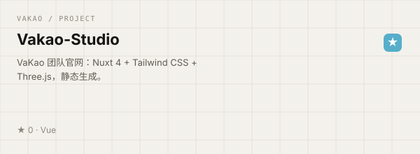</picture></a>
</td>
<td width="50%">
<a href="https://github.com/Rouarn/WireDeck"><picture><source media="(prefers-color-scheme: dark)" srcset="./assets/projects/WireDeck-dark.svg">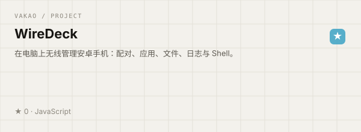</picture></a>
</td>
</tr>
<tr>
<td width="50%">
<a href="https://github.com/Rouarn/DianMo"><picture><source media="(prefers-color-scheme: dark)" srcset="./assets/projects/DianMo-dark.svg">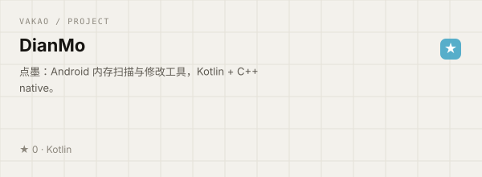</picture></a>
</td>
<td width="50%">
<a href="https://github.com/Rouarn/OnmyojiTools"><picture><source media="(prefers-color-scheme: dark)" srcset="./assets/projects/OnmyojiTools-dark.svg">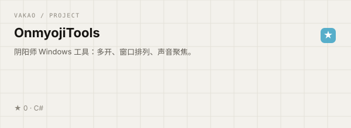</picture></a>
</td>
</tr>
<tr>
<td width="50%">
<a href="https://github.com/Rouarn/VakaoUI"><picture><source media="(prefers-color-scheme: dark)" srcset="./assets/projects/VakaoUI-dark.svg">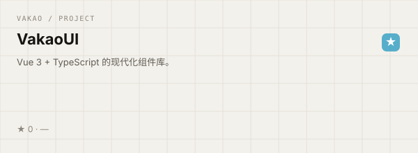</picture></a>
</td>
<td width="50%">
<a href="https://github.com/Rouarn/VakaoStaticHub"><picture><source media="(prefers-color-scheme: dark)" srcset="./assets/projects/VakaoStaticHub-dark.svg">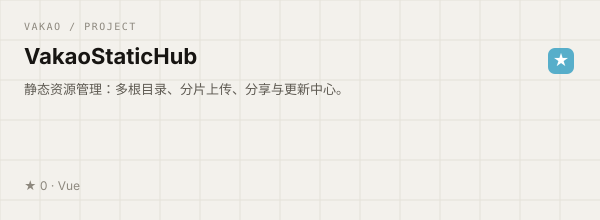</picture></a>
</td>
</tr>
</table>

> 更多项目见 [woyuxiaji.cn/open-source](https://woyuxiaji.cn/open-source)。

---

### 贡献

<picture>
  <source media="(prefers-color-scheme: dark)" srcset="./assets/generated/activity-dark.svg">
  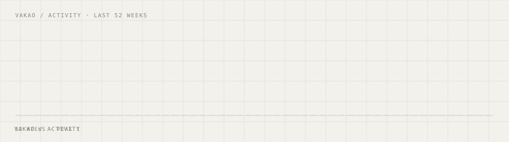
</picture>

<picture>
  <source media="(prefers-color-scheme: dark)" srcset="https://raw.githubusercontent.com/Rouarn/Rouarn/output/github-contribution-grid-snake-dark.svg">
  <source media="(prefers-color-scheme: light)" srcset="https://raw.githubusercontent.com/Rouarn/Rouarn/output/github-contribution-grid-snake.svg">
  
</picture>

---

### 技术栈

  
  
  
  
  
  
  
  
  

  统计卡与项目卡由仓库内 GitHub Actions 生成，不依赖第三方图片服务。 · VaKao / 把想法做成每天都在用的工具。

